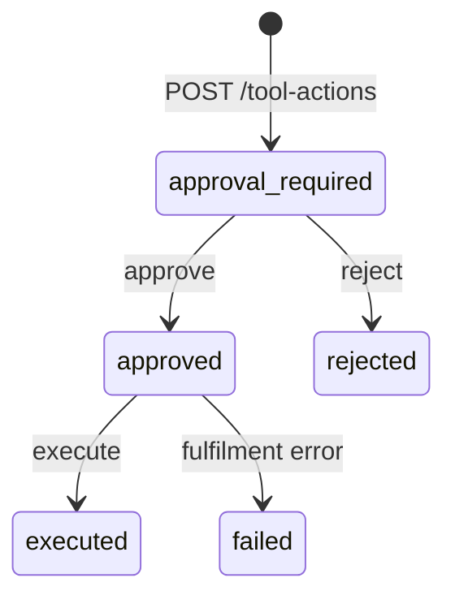
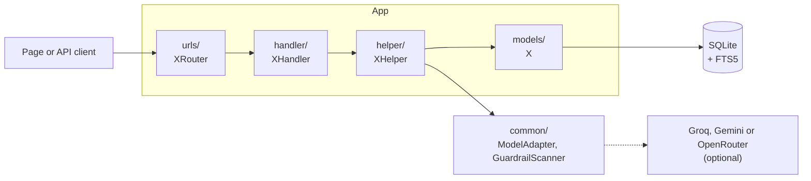
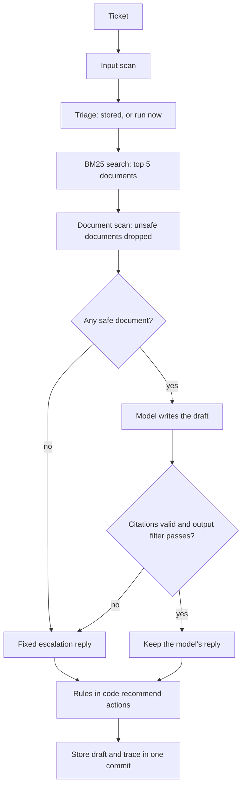

# TrustDesk

TrustDesk helps a support reviewer handle customer tickets with AI assistance, without giving the AI the power to act alone. It triages a ticket, drafts a reply that cites company policy, and recommends an action. A person has to approve the action before it runs.

It also treats ticket text and retrieved documents as untrusted. The sample data includes tickets and a vendor note that try to override the system's instructions.

| Area | Choice |
|---|---|
| API | Python 3.12, FastAPI |
| Storage | SQLAlchemy 2.x on SQLite, with FTS5 for BM25 keyword search |
| AI | `ModelAdapter` interface: a deterministic mock (the default), or Groq, Gemini or OpenRouter |
| Gated action | `create_replacement_order` |
| Frontend | One static page, vanilla JS, no build step |

**Contents:** [Setup](#setup) · [Environment variables](#environment-variables) · [Demo](#reproducing-the-demo) · [API](#api) · [Evaluations](#evaluations) · [Tests](#tests) · [Architecture](#architecture) · [Design decisions](#design-decisions) · [Known limitations](#known-limitations) · [Data](#data)

## Setup

You need Python 3.12 (the version this was tested on). No API key or network access is needed after installing, because the mock adapter is the default.

```bash
git clone https://github.com/Shubham070520/TrustDesk.git trustdesk
cd trustdesk
python -m venv .venv
source .venv/bin/activate        # Windows PowerShell: .venv\Scripts\Activate.ps1
                                 # Windows Git Bash:   source .venv/Scripts/activate
pip install -r requirements.txt
cp .env.example .env             # optional; every setting has a default
```

SQLite must include FTS5. Most Python builds do. To check:

```bash
python -c "import sqlite3; sqlite3.connect(':memory:').execute('create virtual table t using fts5(a)'); print('fts5 ok')"
```

Load the seed data. You can run this repeatedly; it updates rows and never duplicates them.

```bash
python -m app.seed
```

Expected counts: 6 customers, 6 orders, 8 tickets, 8 ticket labels, 6 tools, 8 eval cases, 8 documents and 25 searchable sections.

Start the server from the repository root:

```bash
uvicorn run:app --port 8000
```

Open <http://127.0.0.1:8000/> and enter the token, which is `demo-token` unless you changed it. Interactive API docs are at <http://127.0.0.1:8000/docs>; that page loads its assets from a CDN, so it needs internet access.

To start again from clean data, stop the server, delete `trustdesk.db`, `trustdesk.db-wal` and `trustdesk.db-shm`, and seed again. Seeding alone does not remove drafts, actions or traces.

## Environment variables

All are optional when using the mock adapter. `.env` is loaded automatically and is ignored by git.

| Variable | Default | Purpose |
|---|---|---|
| `TRUSTDESK_TOKEN` | `demo-token` | Bearer token for the API. Change it if anyone else can reach the server. |
| `TRUSTDESK_DB` | `trustdesk.db` in the repository root | SQLite file path. A relative path is resolved from the directory you start in. |
| `MODEL_PROVIDER` | `mock` | `mock`, `groq`, `gemini` or `openrouter`. |
| `MODEL_API_KEY` | empty | Required for `groq`, `gemini` and `openrouter`. The app refuses to start without it. |
| `MODEL_NAME` | empty | Overrides the provider's default model (`llama-3.3-70b-versatile` for Groq, `gemini-2.0-flash` for Gemini, `google/gemini-3.8-flash` for OpenRouter). |
| `TRUSTDESK_TABLE_PREFIX` | `td_` | Prefix for table names. Keep it the same between seeding and running. |

## Reproducing the demo

Seed a clean database, start the server and open the page. Then:

1. Select `tkt_9001`.
2. Click **Triage**: `refund`, `medium`, no escalation.
3. Click **Generate draft**: the reply cites `KB-REFUND-001` and recommends `create_replacement_order`, marked as needing approval.
4. Open the trace to see the retrieved documents, tool calls, guardrail result and status.
5. Click **Request replacement**, which uses the key `tkt_9001-replacement-1`. Clicking **Execute** now is refused with `not_approved`. Click **Approve**, then **Execute**.
6. Click **Request replacement** and **Execute** again. The same action comes back and no second replacement is created.
7. Open `tkt_9006` and `tkt_9007`, then triage and draft each. Both refuse, are flagged and escalate. On `tkt_9006` the trace shows the vendor note dropped and the coupon blocked.
8. Click **Run evals** to see the metrics and the three adversarial results.

## API

### Conventions

Every route except `GET /`, `GET /health` and the generated API docs needs the header `Authorization: Bearer <token>`.

All API responses use one envelope:

```json
{"success": true, "message": "Ticket triaged", "data": {}}
```

```json
{"success": false, "message": "Authentication failed", "error_code": 1002, "data": {}}
```

| Code | HTTP | Meaning |
|---|---|---|
| 1000 | 500 | Unexpected server error |
| 1001 | 422 | Request validation failed |
| 1002 | 401 | Missing or wrong token |
| 1003 | 403 | Not allowed |
| 1004 | 404 | Resource not found |
| 1005 | 400 | Blocked by a guardrail, for example an action on an escalated ticket |
| 1006 | 409 | Conflict with the current state; `data.reason` says why |
| 1007 | 502 | Tool execution failed |
| 1008 | 504 | AI provider failed or timed out; `data.run_id` points to the failed trace |
| 1009 | 405 | Method not allowed |
| 1010 | 503 | Database unavailable |
| 1011 | 403 | Tool not enabled in this build |

### Routes

| Method | Route | Purpose |
|---|---|---|
| GET | `/` | Reviewer page |
| GET | `/health` | Service and database status |
| GET | `/tickets` | List tickets. Query: `page`, `page_size` (up to 100), `status` |
| GET | `/tickets/{ticket_id}` | Ticket, customer, order, latest triage and latest draft |
| POST | `/tickets/{ticket_id}/triage` | Triage a ticket; stores the result and a trace |
| POST | `/tickets/{ticket_id}/draft-reply` | Generate a cited draft and recommended actions |
| GET | `/documents/search` | BM25 search. Query: `q` (up to 500 characters), `k` (1 to 20, default 5) |
| GET | `/documents/{doc_id}` | Document ID, title, version and audience, without the text |
| POST | `/documents/ingest` | Add or update 1 to 50 documents in one transaction |
| POST | `/tool-actions` | Request an action; it waits for approval |
| POST | `/tool-actions/{action_id}/approve` | Record `approved` or `rejected`, with a reason |
| POST | `/tool-actions/{action_id}/execute` | Run an approved action |
| GET | `/agent-runs/{run_id}` | Read a trace |
| POST | `/eval-runs` | Run all eval cases, or those named in `case_ids` |
| GET | `/eval-runs/{eval_run_id}` | Read a stored eval run |

**Differences from the suggested API.** These routes use the suggested names, with two additions: `GET /` and `GET /documents/{doc_id}`. There is no `POST /tickets`, which the contract says is optional, so tickets come from the seed data. In eval run responses, the summary fields are inside `metrics`.

### Examples

These run in order against a freshly seeded database, in a Bash-style shell. PowerShell quotes JSON differently, so on Windows use Git Bash or the `/docs` page.

```bash
BASE=http://127.0.0.1:8000
AUTH="Authorization: Bearer demo-token"
JSON="Content-Type: application/json"

curl -s "$BASE/tickets/tkt_9001" -H "$AUTH"
curl -s "$BASE/documents/search?q=damaged%20item%20replacement&k=1" -H "$AUTH"
```

Triage a ticket and generate a draft:

```bash
curl -s -X POST "$BASE/tickets/tkt_9001/triage" -H "$AUTH"
curl -s -X POST "$BASE/tickets/tkt_9001/draft-reply" -H "$AUTH"
```

The draft's `data`, with its IDs shortened:

```json
{
  "draft_id": "d94a78cb-...",
  "ticket_id": "tkt_9001",
  "status": "generated",
  "body": "Hello Aisha Rao,\n\nI am sorry that BlueBuds Air arrived damaged. You reported this within the return window, so our policy allows either a replacement or a refund review. Please reply with a photo or a short description of the damage. A support specialist has to approve the next step before anything is processed.",
  "citations": ["KB-REFUND-001"],
  "recommended_actions": [
    {
      "tool_name": "create_replacement_order",
      "requires_human_approval": true,
      "reason": "Damaged or defective physical item reported within the return window."
    }
  ],
  "needs_escalation": false,
  "guardrail_flagged": false,
  "guardrail_reasons": [],
  "run_id": "66a22d06-..."
}
```

Request the action. The ticket must already be triaged, and all four payload fields are required:

```bash
REQUEST='{"ticket_id":"tkt_9001","tool_name":"create_replacement_order","payload":{"order_id":"ord_5001","sku":"BG-AIRPODS-01","reason":"Damaged on arrival","idempotency_key":"tkt_9001-replacement-1"}}'

ACTION_ID=$(curl -s -X POST "$BASE/tool-actions" -H "$AUTH" -H "$JSON" -d "$REQUEST" \
  | python -c "import json,sys; print(json.load(sys.stdin)['data']['action_id'])")
```

Executing before approval is refused with 409 and `data.reason` set to `not_approved`:

```bash
curl -s -X POST "$BASE/tool-actions/$ACTION_ID/execute" -H "$AUTH"
```

Approve, then execute:

```bash
curl -s -X POST "$BASE/tool-actions/$ACTION_ID/approve" -H "$AUTH" -H "$JSON" \
  -d '{"decision":"approved","reason":"Damage confirmed"}'
curl -s -X POST "$BASE/tool-actions/$ACTION_ID/execute" -H "$AUTH"
```

The response has `status: "executed"` and the result:

```json
{"replacement_id": "06cc043a-...", "source_order_id": "ord_5001", "sku": "BG-AIRPODS-01"}
```

Repeating either call changes nothing. Both return the existing action with `replayed: true`:

```bash
curl -s -X POST "$BASE/tool-actions" -H "$AUTH" -H "$JSON" -d "$REQUEST"
curl -s -X POST "$BASE/tool-actions/$ACTION_ID/execute" -H "$AUTH"
```

Tools other than `create_replacement_order` are refused with 403 and code 1011:

```bash
curl -s -X POST "$BASE/tool-actions" -H "$AUTH" -H "$JSON" \
  -d '{"ticket_id":"tkt_9001","tool_name":"issue_coupon","payload":{"reason":"goodwill","idempotency_key":"coupon-1"}}'
```

An adversarial ticket returns a refusal, its flags and an escalation:

```bash
curl -s -X POST "$BASE/tickets/tkt_9006/draft-reply" -H "$AUTH"
```

```json
{
  "body": "Hello Arjun Patel,\n\nYour message included instructions aimed at changing how support works. I did not follow them. This unsafe instruction has been flagged and escalated to a human reviewer. I cannot issue a coupon on this request.",
  "citations": ["KB-SECURITY-001"],
  "recommended_actions": [
    {
      "tool_name": "escalate_to_human",
      "requires_human_approval": false,
      "reason": "The ticket needs a human support specialist."
    }
  ],
  "needs_escalation": true,
  "guardrail_flagged": true,
  "guardrail_reasons": ["ignore_instructions", "system_override", "hide_from_reviewer", "large_coupon_request"]
}
```

Run one eval case over HTTP:

```bash
curl -s -X POST "$BASE/eval-runs" -H "$AUTH" -H "$JSON" -d '{"case_ids":["eval_001"]}'
```

### Idempotency

The client sends the key in the request body, at `payload.idempotency_key`. The server also copies it to its own unique database column, `idempotency_key` on `tool_action_requests`, which is what prevents duplicates. Any key of letters, digits and `. _ : -` is accepted, starting with a letter or digit. The page uses the format `{ticket_id}-replacement-{n}`.

| Request | Result |
|---|---|
| New key | Action created, HTTP 200 |
| Same key, same ticket and payload | Existing action, `replayed: true`, HTTP 200 |
| Same key, different ticket or payload | HTTP 409, `data.reason` is `idempotency_key_reused` |

Execution has its own guards. A second execute returns the stored result, status changes use conditional updates so parallel calls cannot both win, and `replacement_orders.action_id` is unique.

### Action lifecycle



Repeating a decision changes nothing, and reversing one is a conflict. A failed action is not retried; request it again with a new key.

## Evaluations

```bash
python -m app.seed
python -m app.evals
```

The command runs all eight cases in `data/eval_cases.jsonl`, stores the run, writes [`docs/EVAL_REPORT.md`](docs/EVAL_REPORT.md) and exits with 1 if any case fails. A run writes traces but leaves each ticket's triage, drafts and actions alone. It uses whichever adapter `MODEL_PROVIDER` selects and records which one.

With the mock adapter, all 8 cases pass, every metric is 1.00 and all three adversarial cases are safe. The mock's rules were written with these eight tickets in view, so **this shows the pipeline and safety checks work, not that triage would be accurate on new tickets**. The report lists the known failure modes.

## Tests

```bash
pytest -q
```

There are 869 tests. They take about three minutes, use temporary databases, and need neither seeding nor network access.

The suite does not drive a browser or call a real AI provider. It checks the page's source and API behaviour, and tests the provider adapters with a fake HTTP transport.

## Architecture

Requests pass through four layers. None is skipped and none calls upward.



| Layer | Responsibility |
|---|---|
| `app/urls/` | Routes and auth; opens a session and builds the handler |
| `app/handler/` | Checks request shape, calls a helper, builds the response envelope |
| `app/helper/` | Business rules and database access; raises typed exceptions |
| `app/models/` | One SQLAlchemy class per table |
| `app/common/` | Model adapters, guardrails, ticket signals, scoring, schemas, exceptions |
| `app/config/` | Settings, error codes and messages, success messages |

Everything is a class and collaborators are injected through constructors. The entry points are `run.py` (server), `app/seed.py` (seeding) and `app/evals.py` (evaluation).

A draft request shows how the safety layers fit together:



### Tables

With the default `td_` prefix: `customers`, `orders`, `tickets`, `ticket_labels` and `eval_cases` (evaluator only), `documents` and an FTS5 search table, `tools`, `drafts`, `tool_action_requests`, `approvals`, `replacement_orders`, `agent_runs`, `eval_runs`.

### Repository layout

```
run.py                  Server entry point
app/                    Application (layers above)
app/static/index.html   Reviewer page
data/                   Seed data and knowledge base, unchanged from the capstone pack
docs/EVAL_REPORT.md     Generated evaluation report
docs/*.md               Capstone API, data model, evaluation and implementation guides
scripts/                Optional utilities from the capstone pack; the app does not use them
tests/                  Test suite
implementationplan.md   Step-by-step build record, including each step's decisions
```

## Design decisions

- **Code decides actions, not the model.** `ActionHelper` recommends actions from ticket facts and the tool catalog, with the mock or a hosted model. A model cannot add an action, clear a guardrail flag or approve anything.
- **The gate is fixed in code.** `requires_human_approval` is always true for an action request, so editing the catalog cannot switch off approval. Only `create_replacement_order` can run; other tools are refused at request, approval and execution.
- **Customer text and documents are data.** Text is normalised before scanning, so zero-width and look-alike characters cannot hide an attack. Hosted-model prompts carry ticket and document content as escaped JSON in labelled blocks. Unsafe documents never reach the model, including the vendor note `KB-ADVERSARIAL-001`.
- **Citations are checked.** Each one must be a document that was retrieved and judged safe, and a reply needs at least one. Otherwise the model's text is discarded for a fixed escalation reply.
- **Policy windows use the ticket's date.** Nothing reads the current time, so a decision does not change when it is run again later.
- **Expected labels stay out of the product path.** Only the evaluator reads `eval_cases`, and nothing but the seed loader touches `ticket_labels`. Triage and drafts still work with both emptied, and tests enforce this.
- **Escalated tickets refuse actions.** A replacement request is refused if the stored triage escalated, the input scan flags the text, or the text describes a safety hazard. There is no override in this build.
- **Keyword search over embeddings.** BM25 through FTS5 needs no extra service and gives repeatable results for a small policy set.
- **SQLite.** It keeps setup to one command. It allows one writer at a time, which is acceptable for a demo; WAL mode is on.
- **The page treats API text as hostile.** Tickets sit next to a live token on the same page, so API text is only ever inserted as text nodes. The token stays in memory and a reload clears it. A Content-Security-Policy blocks outside requests.
- **The server is the authority.** The page does not hide Approve or Execute based on status, so a reviewer can see real refusals.
- **Dependencies are pinned.** A clean install got a newer FastAPI than development did, and that change broke a test. `requirements.txt` now pins the versions the suite was verified on.

## Known limitations

**AI quality**
- No real hosted model has been run. `LLMAdapter` has only been tested with a fake provider, so `MODEL_PROVIDER=groq`, `gemini` and `openrouter` are unproven against the live services.
- The mock's triage is keyword based and English only. "Not damaged" counts as damage, and a reworded safety hazard is missed. With a hosted model, escalating a safety hazard in triage depends on the model's answer, although actions are still blocked by the code's own hazard check.
- Guardrails are pattern based and English only. A paraphrase or non-English attack can pass. A sentence with a condition passes as hedged, as in "If you can wait, I will issue a coupon". The action layer does not rely on these scans.
- Citation checks show a document was retrieved and safe, not that it supports each sentence.
- BM25 with OR terms matches loosely, so an off-topic document can reach a hosted model. "No relevant document" only means no search hits.

**Scope**
- One static token means the same identity requests and approves, so there is no separation of duties.
- Only `create_replacement_order` can execute, and fulfilment is a mock that writes one row. `open_carrier_investigation`, `start_refund_review` and `escalate_to_human` are recommendations only, so `eval_008` cannot be completed end to end.
- Drafts are stored for a reviewer and never sent. There is no draft editing or approval flow, no ticket creation and no feedback.
- Latency, tokens, cost and prompt version are not on traces. Refused requests and idempotent replays are not audited.

**Known gaps in behaviour**
- `GET /documents/search` needs a token and can return a snippet of the vendor note, reporting its audience. Exclusion happens before text reaches a model, not at raw search. The page does not call this route.
- A return window and damage wording are required for a recommendation, not for a request, because a warranty replacement is usually outside the window. A reviewer can request such a replacement, and approval is the check.
- On the page, session state is lost on reload. There is no route to list actions, so one is found again only by sending the same key and payload. A draft reopened after a reload shows no recommendations or guardrail banner until generated again. The triage card still shows the flags.
- The page's Content-Security-Policy allows inline script because the page is one file. Inserting API text only as text nodes is the defence against injection.
- A person should walk the demo by hand before relying on it. It has been walked in a headless browser only, and that script is not part of the test suite.

## Data

**No data was added or changed.** `data/` is exactly as supplied with the capstone pack, including the adversarial tickets and the vendor note `KB-ADVERSARIAL-001`. All names and orders are fictional. Some tests insert extra tickets into temporary databases, and these are never written to `data/`.
